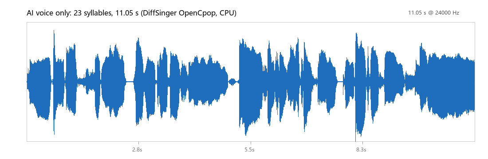

# ai-voice-sing

Turn a song clip into **an AI voice singing along with it** - on a CPU, without a GPU and
without torch for the voice itself.

This is the cleaned-up rebuild of an experiment: take a Mandarin pop song, split it into
vocals and instrumental with Demucs, write down the chorus as a little lyrics+melody score,
let a DiffSinger ONNX voice (OpenCpop, single female Mandarin singer) sing that score, and
mix the result back over the instrumental.

The voice engine is **ONNX Runtime only** (~220 MB of weights, no PyTorch at inference
time), so the synthesis step runs on any laptop.  Separation and automatic melody drafting
are optional extras that do need torch/librosa.

| demo | what it is |
|---|---|
| [`demo/yua-chorus-sung.wav`](demo/yua-chorus-sung.wav) | a cappella: 23 syllables, 11.05 s, 24 kHz mono |
| `demo/yua-chorus-mix.wav` | the same vocal mixed over the original instrumental, 15.5 s - **not shipped here**: the mix embeds a 15 s excerpt of a commercial recording. Reproduce it locally with `scripts/cover.py` on your own file. |
| [`demo/waveform.png`](demo/waveform.png) / [`demo/waveform-mix.png`](demo/waveform-mix.png) | waveforms |



Both wav files in `demo/` are real output of this code, produced by the commands shown
below.  The lyrics are the chorus of 雨爱 (Rain Love, 杨丞琳); the melody is a hand
transcription of the original - see [Limitations](#limitations) for what that means.

Reproducing the shipped demo exactly (the model was already in `models/opencpop/`):

```bash
python scripts/sing.py --score scores/yua-chorus.json --out demo/yua-chorus-sung.wav
python scripts/cover.py --song 雨爱.mp3 --start 86 --dur 15.5 \
    --score scores/yua-chorus.json --offset 1.0 --out demo/yua-chorus-mix.wav
python scripts/plot_waveform.py demo/yua-chorus-sung.wav demo/waveform.png --title "AI voice only"
python scripts/plot_waveform.py demo/yua-chorus-mix.wav demo/waveform-mix.png --title "AI voice over the instrumental"
```

## Pipeline

```
song.mp3
  |  scripts/separate.py          Demucs htdemucs (optional: torch)
  +--------------> vocals.wav
  +--------------> instrumental.wav

vocals.wav
  |  scripts/song_to_score.py     pYIN (optional: librosa)
  v
draft score.json
  |  by hand: fix the lyrics, pitches and durations
  v
score.json  {"syllables": [ ... ]}

score.json
  |  scripts/sing.py              ONNX Runtime, CPU, 24 kHz, ~3.4x realtime
  v
+----------------------------------------------------------------+
| DiffSinger voice                                               |
|   fs2.onnx        text + MIDI + note lengths   ->  mel         |
|   pe.onnx         mel  ->  f0    (or the F0 curve from score)  |
|   p_/q_sample    100-step diffusion sampler                    |
|   vocoder.onnx    mel + f0  ->  wav                            |
+----------------------------------------------------------------+
  v
vocal_ai.wav --------+
                     |  scripts/sing.py --mix ...
instrumental.wav ----+  or scripts/cover.py (does all of the above)
                     v
                 cover.wav
```

Two passes over the score are worth knowing about:

* **chunking** - one ONNX call is limited to ~10 words (`max_frames: 8000` at 100 fps), so
  `ds_engine.py` splits the score at 5 s and writes every chunk at its exact sample offset
  in a silent buffer (no concatenation clicks, no cumulative timing drift).
* **F0 override** - by default the vocoder is fed a pitch curve built *from the score*
  (portamento + a little vibrato) instead of the model's own pitch prediction.  That makes
  the rendered pitch exact and deterministic; `--f0 model` uses the model's prediction.

## Verified results

Measured on the development machine (Windows 11, laptop CPU, Python 3.12.14):

| step | time |
|---|---|
| load the five ONNX graphs | ~4 s |
| sing 23 syllables / 11.05 s of score (`--f0 score`) | ~37 s |
| sing the same score with `--f0 model` | ~56 s |
| full `cover.py` on a 15.5 s clip (Demucs + synthesis + mix) | ~55 s |

Pitch check of `demo/yua-chorus-sung.wav` with pYIN against the score: median absolute
error **0.0 semitones**, 22 of 23 notes within ±0.2 st (the one miss is the very short,
quiet neutral-tone 的, whose mel is nearly silent).

## Install

Requirements: Python 3.10-3.12, `ffmpeg` on `PATH` (only for mp3/m4a input and cutting).

```bash
python -m venv .venv && . .venv/bin/activate     # Windows: .venv\Scripts\activate
pip install -r requirements.txt
python scripts/fetch_model.py                    # ~220 MB download, ~250 MB unpacked
```

**The weights are not in this repository.**  GitHub rejects files over 100 MB and the five
ONNX graphs are 111 MB (`fs2.onnx`), 65 MB (`p_sample.onnx`), 61 MB (`vocoder.onnx`),
18.5 MB (`pe.onnx`) and 34 KB (`q_sample.onnx`), so `fetch_model.py` pulls the official
release zip from
<https://github.com/HighCWu/DiffSinger-ONNX-Infer/releases/download/v0.1/model.zip>
(220,222,146 bytes, sha256 `598739ffde0b10a51dfef74ab0ec1eb2820941f4b81ada64079b733e895c9c77`),
verifies the hash and unpacks `config.yaml` + the five graphs into `models/opencpop/`
(git-ignored, never published).  Already have the zip?
`python scripts/fetch_model.py --zip model.zip`.

Optional extras (separation, melody drafting): `pip install -r requirements-optional.txt`
- this pulls PyTorch (~2 GB) and librosa.  Without them `separate.py` falls back to a crude
centre-cancellation instrumental and `song_to_score.py` is unavailable.

## Quick start

```bash
# 0. once: fetch the ~220 MB model (see Install; skipped if models/opencpop exists)
python scripts/fetch_model.py

# 1. the voice alone: a cappella from a score
python scripts/sing.py --score scores/yua-chorus.json --out demo/out.wav

# 2. separate a clip of the song (needs the optional Demucs install)
python scripts/separate.py --input song.mp3 --start 86 --dur 16 --outdir work

# 3. sing the score over that instrumental
python scripts/sing.py --score scores/yua-chorus.json \
    --mix work/instrumental.wav --mix-offset 1.0 --out demo/mix.wav

# 4. draw a waveform
python scripts/plot_waveform.py demo/out.wav demo/out.png --title "AI voice"
```

Or all of it in one command:

```bash
python scripts/cover.py --song song.mp3 --start 86 --dur 16 \
    --score scores/yua-chorus.json --offset 1.0 --out work/cover.wav
```

`cover.py` cuts the clip, separates it (`--method demucs|centre|auto`), renders the score,
and mixes.  Already have stems?  `--instrumental work/instrumental.wav --vocal work/vocals.wav`
skips separation entirely.

## Score format

A score is a plain JSON file.  Each entry is either a sung syllable or a rest:

```json
{
  "title": "chorus of 雨爱 - hand transcription",
  "syllables": [
    {"lyric": "雨", "notes": ["B4"], "durs": [0.6]},
    {"lyric": "爱", "notes": ["E4"], "durs": [0.3]},
    {"rest": 0.15},
    {"lyric": "续", "notes": ["E4"], "durs": [1.2]},
    {"lyric": "延", "notes": ["D#5", "E4"], "durs": [0.3, 0.3]}
  ]
}
```

* `lyric` - one Chinese character (it is converted to pinyin phonemes; `a`, `la`, `ah`
  also work as filler).
* `notes` - scientific pitch names.  One entry per note; several entries = a slur where
  the note changes inside the syllable (`durs` must have the same length).
* `durs` - seconds per note.
* `rest` - silence length in seconds (no word is synthesised, which is also what keeps
  chunk boundaries clean).
* `--transpose N` shifts every pitch by N semitones.

Only the pinyin matters for pronunciation, so homophone characters are fine.  The voice
cannot do English words; see Limitations.

## Scripts

| script | what it does | needs |
|---|---|---|
| `scripts/fetch_model.py` | download + verify the OpenCpop ONNX model | - |
| `scripts/sing.py` | score -> vocal wav, optional mix | core |
| `scripts/ds_engine.py` | the engine (chunking, F0 curves, vocoder calls) | core |
| `scripts/plot_waveform.py` | waveform PNG with Pillow | core + Pillow |
| `scripts/separate.py` | Demucs vocal/instrumental split, or centre cancellation | optional |
| `scripts/song_to_score.py` | pYIN melody draft -> score JSON (approximate) | optional |
| `scripts/cover.py` | the whole chain in one command | optional (for separation) |

`sing.py` flags: `--score --out --transpose --f0 {score,model,model+fix} --vibrato
--seed --max-chunk --model-dir --mix --mix-offset --vocal-gain --peak`.

## Limitations

Read this before asking it to cover a whole song.

* **One voice.** The model is the OpenCpop corpus: a single Mandarin female singer, 24 kHz.
  There is no voice cloning here - swap voices by swapping the model.
* **Mandarin only.** Text goes through pinyin -> phoneme conversion; English lyrics come
  out as nonsense syllables.
* **The melody is yours to write.** `song_to_score.py` is a draft helper: pYIN smears
  unvoiced consonants, drops octave on short high notes, and invents rests.  The demo score
  is hand-typed, not auto-extracted - that is the honest state of this pipeline.
* **No beat-locking.** `cover.py` places the sung vocal at `--offset` inside the clip; it
  does not time-warp it to the original singer's rhythm.  A hand score will not match the
  record's groove exactly - it is a cover, not a lip-sync.
* **Mixing is a dry sum** (instrumental 0.85, vocal 0.55, peak-normalised).  No EQ, no
  reverb, no ducking.  `--vocal-gain` is the only knob.
* **Octave slips on `--f0 model`** for short high notes; `--f0 score` (the default) avoids
  them entirely.  The model's own prediction has slightly livelier glides, which is why the
  option exists.
* **Slow-ish, single-threaded ONNX CPU run**: about 3.4x realtime for the vocal.
* Separation with Demucs is MIT code but pulls torch; centre cancellation is much worse
  and gives you an instrumental only.

## Vendored code and credit

`vendor/diffsinger_onnx/` is a modified copy of
[HighCWu/DiffSinger-ONNX-Infer](https://github.com/HighCWu/DiffSinger-ONNX-Infer)
(MIT, © 2022 艾梦).  Modifications, all recorded in that file:

1. dropped `tqdm` and `librosa` imports (toned down to plain loops and a local
   `note_to_midi`) so the engine needs only numpy/onnxruntime/soundfile/pypinyin/PyYAML;
2. `Infer(hparams, model_dir=...)` instead of the hard-coded `model/` path;
3. `f0_override` hook so the caller can feed its own pitch curve to the vocoder, plus
   `last_mel`/`last_f0` exposed for debugging.

Upstream model: DiffSinger (Liu et al., *DiffSinger: Singing Voice Synthesis via Shallow
Diffusion Mechanism*, AAAI 2022), trained on the
[OpenCpop](https://github.com/MoonInTheRiver/DiffSinger/blob/master/resources/README.md)
singing corpus, exported to ONNX by the project above.

Other credits: [Demucs](https://github.com/facebookresearch/demucs) (vocal separation),
[librosa](https://librosa.org/) pYIN (melody drafting).

## License

MIT - see [LICENSE](LICENSE).  The downloaded weights are **not** part of this repository;
they come from the upstream project and were trained on OpenCpop, so treat them as
research-use and check the upstream terms before publishing generated audio commercially.
